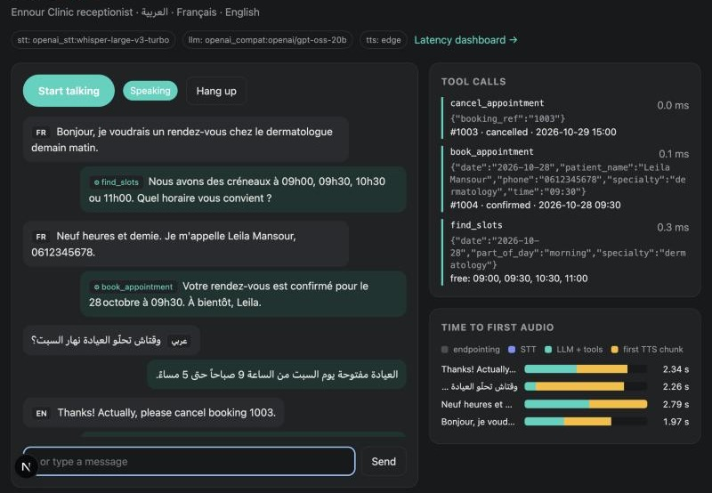
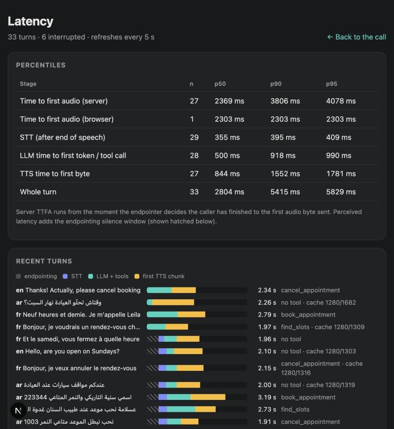
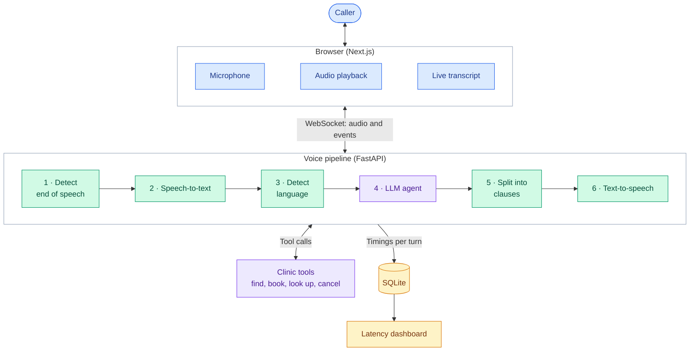

# VoiceDesk

A real-time voice agent that answers calls in Arabic, French and English and completes
tasks through tool calls. The demo is a receptionist for a fictional clinic: callers can
book, look up and cancel appointments, ask common questions, and interrupt the agent
mid-sentence.

Every stage of every turn is timed, and an eval suite scores language detection, tool
calls and task success on scripted conversations.



**Stack:** Python, FastAPI, WebSockets, asyncio, Next.js, SQLite, Docker Compose.

**Models and services (interchangeable):**

| Stage | Options |
|---|---|
| Speech-to-text | Groq or OpenAI Whisper, faster-whisper (local), Deepgram |
| LLM | Any OpenAI-compatible API (Groq, Gemini, Ollama), llama.cpp (local) |
| Text-to-speech | edge-tts, ElevenLabs |

## Results

All figures come from runs in this repository. The raw data is in
[`evals/results/`](evals/results) and [`docs/benchmarks/`](docs/benchmarks).

### Task performance

18 scripted conversations with 23 caller turns:

| Pipeline | Language detection | Transcription error (CER) | Tool calls | FAQ answers | Reply language | Task success |
|---|---|---|---|---|---|---|
| Audio, Groq Whisper turbo, gpt-oss-20b | 100% | 3% | 96% | 100% | 100% | **94%** (17/18) |
| Text, gpt-oss-20b | 100% | – | 100% | 100% | 100% | **100%** (18/18) |
| Text, Qwen2.5-1.5B Q4 (local, CPU) | 100% | – | 61% | 100% | 96% | 61% (11/18) |

Task success on the full audio path was 100% for English, French, Modern Standard Arabic,
Gulf Arabic and mixed French/Arabic, and 67% for Tunisian Arabic. The one failure:
«الساعة جوج ونص» ("half past two" in Tunisian) was booked as 14:00 instead of 14:30.

### Latency

23 caller utterances streamed in real time to a live server, using Groq Whisper turbo,
Groq gpt-oss-20b and edge-tts, with the server on a 2019 Intel i7-9750H laptop:

| Stage | p50 | p90 |
|---|---|---|
| Speech-to-text | 359 ms | 403 ms |
| LLM, time to first token or tool call | 517 ms | 903 ms |
| Text-to-speech, time to first byte | 806 ms | 1,520 ms |
| **Server: end of speech detected to first audio sent** | **2.54 s** | **3.85 s** |
| **Caller: stopped talking to first audio received** | **3.04 s** | **4.39 s** |

The caller figure includes the 550 ms of silence used to detect the end of speech.
Text-to-speech is the largest single stage, followed by that silence window, then the LLM.
Median time to first audio by language: English 2.37 s, French 2.34 s, Arabic 2.88 s.

### Local speech-to-text

faster-whisper on the same CPU:

| Model | Language detection | CER, all | CER, Modern Standard Arabic | CER, Tunisian | p50 latency |
|---|---|---|---|---|---|
| `small` int8 | 100% | 5% | 9% | 5% | 3.7 s |
| `base` int8 | 100% | 18% | 35% | 45% | 1.3 s |

`base` is too inaccurate for Arabic, so `small` is the local default.



## How it works



Each turn runs through these steps:

1. **Detect the end of speech.** An energy-based voice activity detector ends the
   utterance after 550 ms of silence.
2. **Transcribe** the utterance.
3. **Detect the language** from the script and common words, using the speech-to-text
   model's guess only as a tie-breaker. Short replies such as "ok" keep the call's current
   language.
4. **Run the agent.** The LLM streams its answer and can make up to three rounds of tool
   calls.
5. **Synthesise by clause.** The text is split at the first clause boundary, so audio
   generation starts while the LLM is still writing.

**Interruptions.** If the caller talks over the agent, the server cancels the LLM and
text-to-speech requests, the browser clears its audio queue, and the partial answer is
saved to the conversation history as interrupted. If the caller resumes before any answer
audio was sent, both utterances are merged into one turn.

## Design decisions

- **Custom pipeline instead of Pipecat or LiveKit Agents.** Those frameworks suit
  production telephony. Building the pipeline directly gives full control over speech
  detection, cancellation and latency measurement.
- **WebSocket instead of WebRTC.** It is simple to deploy and to benchmark without a
  browser, but has no packet-loss handling, so WebRTC is the better fit for mobile networks.
- **Static facts in the prompt, tools only for changing data.** Small models answered
  questions about hours and prices from their own priors instead of calling a tool. Moving
  those facts into the system prompt and adding few-shot examples raised the local model's
  task success from 17% to 61%. The FAQ grading changed at the same time, so the two
  figures are not strictly comparable.
- **Tools designed for speech.** Tools take a specialty, date and time rather than slot IDs,
  and booking references accept forms such as "ENR 1002", "1002" or "١٠٠٢". Errors list the
  available alternatives, so the model can recover in one round.
- **Language detection based mostly on text.** Speech-to-text language guesses are noisy on
  clips of 1–3 seconds. Script and common-word checks were correct on all 23 eval turns.
- **Rate-limit waits tracked separately.** Time spent waiting on API rate limits is recorded
  on its own, so it doesn't distort model latency figures.

## Getting started

Requires Python 3.11–3.12 with [uv](https://docs.astral.sh/uv/), and Node 22.

```bash
make setup                      # install backend and frontend dependencies
cp .env.example backend/.env    # choose providers and add API keys
make models                     # only for the local LLM (about 1 GB)
make dev-backend                # http://localhost:8000
make dev-frontend               # http://localhost:3000
```

To run with Docker instead: `make models && docker compose up --build`.

### Provider configuration

Set these in `backend/.env`. [`.env.example`](.env.example) lists every option.

| Setup | Variables | Notes |
|---|---|---|
| Hosted (used for the results above) | `VOICEDESK_STT=openai_stt` `VOICEDESK_LLM=openai_compat` `VOICEDESK_OPENAI_API_KEY=<key>` | Works on Groq's free tier, with rate limits |
| Local | Defaults (`whisper`, `llamacpp`) | No API keys, but too slow for real-time use on CPU; text-to-speech still needs internet |
| Deepgram speech-to-text | `VOICEDESK_STT=deepgram` `VOICEDESK_DEEPGRAM_API_KEY=<key>` | Not benchmarked |
| ElevenLabs text-to-speech | `VOICEDESK_TTS=elevenlabs` `VOICEDESK_ELEVENLABS_API_KEY=<key>` | Not benchmarked |

### Tests, evals and benchmarks

```bash
make check         # linting, type checks and tests
make evals-stt     # speech-to-text and language detection only
make evals         # agent on scripted conversations, text input
make evals-audio   # full path from audio fixtures to agent actions
make bench         # real-time latency benchmark; needs a running backend
```

Each eval run writes per-turn results to `evals/results/`. `--min-score` makes a run fail
below a set score, so it can be used as a CI gate.

## Project layout

```
backend/src/voicedesk/
  providers/   speech-to-text, LLM and text-to-speech integrations
  pipeline/    per-caller session: turn handling, interruptions, metrics
  agent/       tool loop, clause splitter, prompts
  domain/      clinic data, tools, FAQ facts
  audio/       speech detection, decoding
  metrics/     SQLite turn storage and percentiles
  api/         FastAPI app
  evals/       scenarios, scoring, runner, CLI
  bench.py     latency benchmark
evals/         scenarios, audio fixtures, saved results
frontend/      Next.js call screen and latency dashboard
```

## Limitations

- **Synthetic test audio.** The 23 audio fixtures are clean, generated speech. Real phone
  audio, accents and background noise will increase errors, so treat these figures as an
  upper bound.
- **Small eval set.** It is enough to catch regressions and compare configurations, but not
  to support fine-grained claims. FAQ answers are graded by keyword matching.
- **Tunisian Arabic.** Support relies on a small glossary in the prompt, and spoken numbers
  and times remain a failure mode.
- **Local mode is slow on CPU.** Whisper `small` takes 3–4 s per utterance and the local LLM
  several seconds per round on the test laptop. GPU and Apple Silicon performance has not
  been measured.
- **Shared local model.** One llama.cpp instance serves all sessions, so concurrent local
  callers queue. Hosted providers don't have this limit.
- **Simple speech detection.** A neural voice activity detector and an end-of-turn model
  could shorten the 550 ms silence window.
- **Not yet verified.** Deepgram and ElevenLabs have no benchmark runs, and the Docker
  Compose setup and CI workflow have not been confirmed working.
